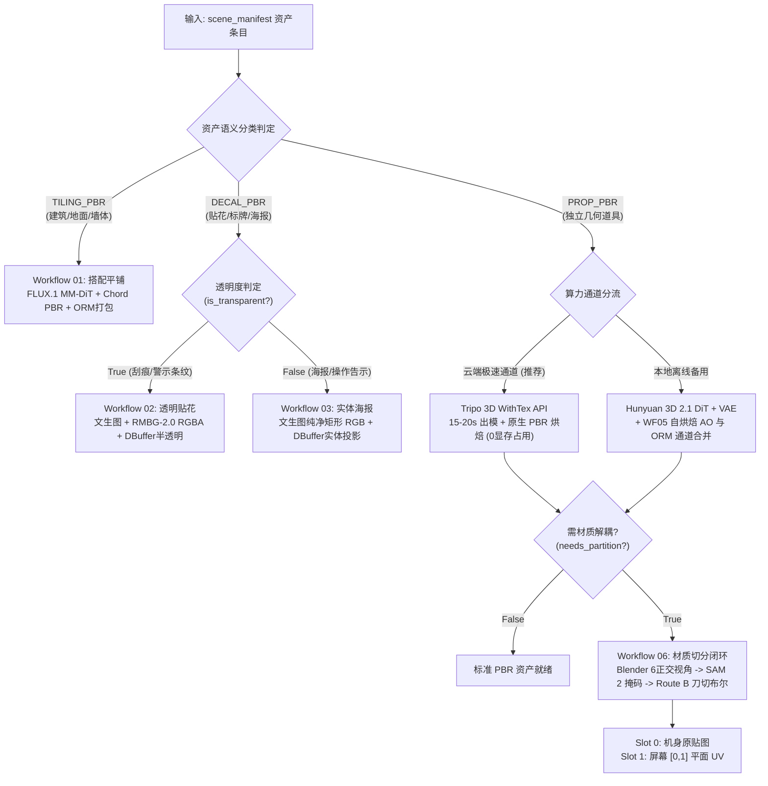

# 阶段二与三：端云协同资产生产与材质解耦 (Asset Generation & Material Partitioning)

本 Skill 专门负责根据阶段一提供的 `scene_manifest.json`，调度 Comfy MCP、Tripo 3D 云端 API、Blender 自动化无头脚本与 SAM 2，批量完成 3D 网格生成、物理 PBR 贴图烘焙、6 视图正交渲染、语义分割与 Route B 刀切解耦，输出符合工业级游戏引擎规格的 `asset_manifest.json`。

---

## 一、学术理论与工业设计哲学 (Theoretical Foundations)

本模块融合了国际图形学与生成式 AI 顶会的最新突破成果：
1. **OmniPart (SIGGRAPH Asia 2025) & PartGen (CVPR 2025 Highlight)**：
   * 针对传统 3D 扩散模型生成“死肉（Monolithic Mesh）”无法局部换材质的缺陷，确立了**“面组解耦与多材质槽（Multi-Material Slots）”**范式；
   * 不做物理碎件补洞，而是通过几何硬切将网格划分为 Slot 0（机身原贴图）与 Slot 1（屏幕独立 $[0, 1]$ 平面正交 UV）。
2. **Ubisoft Chord (SIGGRAPH Asia 2025) & MAGE (CVPR 2025)**：
   * 消除光照烘死，从单图或网格物理反求 G-Buffer（Albedo, Roughness, Metallic, NormalGL），实现真正光照动态响应。
3. **Paint3D (CVPR 2024)**：
   * 基于无光照（Lighting-Less）多视角扩散进行 UV 空间缝隙补全。

---

## 二、端云协同生产架构与 6 大核心工作流

管线针对硬件负载与资产类型自适应调度：



### 1. 01. 搭配平铺工作流 (Texture Semantics)
* **适用**：防静电架空地板、机房吸音墙板、金属天花板；
* **技术核心**：FLUX.1 MM-DiT（12B双流自注意力锁死 90° 直角）+ Universal-Seamless-Tiles（潜空间平移滚动消除接缝）+ Ubisoft Chord 物理反求 + ORM 工业通道打包。

### 2. 02 & 03. 贴花与海报表面附着族 (Decals & Posters)
* **分支 A（透明贴花 `transparent=True`）**：调度 Workflow 02，内置 RMBG-2.0 自动扣除背景输出 RGBA 透明底，引擎使用 `DBuffer_TranslucentColorNormalRoughness`；
* **分支 B（实体海报/标牌 `transparent=False`）**：调度 Workflow 03，文生图直接输出完整矩形画面（免除抠图破坏边缘），引擎使用 `DBuffer_ColorNormalRoughness` 实体投射。

### 3. 04. 3D 几何与 PBR 贴图（端云双通道）
* **通道 A（云端极速推荐：`Tripo_3d_WithTex`）**：
  * 耗时 **15~20 秒**，0 本地显存消耗，输出 20~50 万面高精度带材质模型；
  * 原生导出 `BaseColor`、切线空间法线 `NormalGL` 与 `ORM`。
* **通道 B（本地断网备用：`Hunyuan 3D 2.1`）**：
  * DiT 潜空间预测（steps=12, guidance=5.5）+ 八叉树 VAE 解码 + `BakeAmbientOcclusion` 几何自烘焙 AO。

### 4. 06. 材质语义切分与 Route B 刀切 (Material Clip & Route B Bisect)
* **环境路径**：Blender 可执行文件位于 **`D:/Blenders/blender.exe`**（Blender 4.2 LTS，已永久注入系统 PATH）；
* **步骤一（Blender 6 视图正交渲染）**：`blender_render_ortho.py` 自动以物体系包围盒导出无畸变标准 6 视角；
* **步骤二（ComfyUI SAM 2 提取）**：根据提示词（如 `"screen"`）提取 2D 像素级二值 Mask；
* **步骤三（Blender Route B 几何硬相交）**：`blender_knife_bisect.py` 沿 2D Mask 轮廓挤出棱柱在原网格执行真实相交切割，生成独立几何面组；
* **步骤四（材质槽与 UV 重构）**：
  * `Slot 0 (M_Chassis)`：保留原生烘焙 PBR Atlas UV；
  * `Slot 1 (M_Screen)`：重映射至 $[0, 1] \times [0, 1]$ 平面正交 UV，供游戏引擎直接接入动态发光界面或黑客终端代码图。


---

## 三、PBR 通道标准与交付契约 (`asset_manifest.json`)

| 贴图类型 | 格式与通道 | 色彩空间 | 引擎连接映射 |
| :--- | :--- | :--- | :--- |
| **BaseColor** | RGB (.png) | sRGB | `BaseColor` 引脚 |
| **ORM 复合贴图** | R=Occlusion, G=Roughness, B=Metallic | Linear (sRGB=False) | R $\rightarrow$ `AO`, G $\rightarrow$ `Roughness`, B $\rightarrow$ `Metallic` |
| **Normal** | Tangent Space (.png) | Linear / TC_Normalmap | `Normal` 引脚 |
| **Emissive** | RGB (.png) | sRGB | `Emissive` 引脚（如屏幕绿荧光） |

### 交付清单示例：
```json
{
  "pipeline_id": "RetroServerRoom_V2",
  "assets": [
    {
      "id": "CRT_Monitor",
      "name": "V2_SM_CRT_Monitor",
      "semantic_type": "PROP_PBR",
      "mesh_path": "SourceAssets/RetroServerRoom_V2/Meshes/V2_SM_CRT_Monitor.fbx",
      "material_slots": {
        "0": {
          "slot_name": "M_Chassis",
          "textures": {"BaseColor": ".../T_SM_CRT_Monitor_BaseColor.png", "ORM": ".../T_SM_CRT_Monitor_ORM.png", "Normal": ".../T_SM_CRT_Monitor_Normal.png"}
        },
        "1": {
          "slot_name": "M_Screen",
          "textures": {"BaseColor": ".../T_CRT_Screen_Emissive.png", "Emissive": ".../T_CRT_Screen_Emissive.png", "EmissiveIntensity": 3.0}
        }
      }
    }
  ]
}
```

---

## 四、开箱脚本调用指引

```bash
# 依据场景清单一键批量生成/整理资产交付物
python .agents/skills/ai-asset-generator/scripts/asset_generator_runner.py \
  --scene-manifest scene_manifest.json \
  --source-assets D:/UE5Projects/AutoAIPipelineTest/SourceAssets/RetroServerRoom_V2 \
  --output asset_manifest.json
```
完成后更新 `pipeline_state.json` 为 `STAGE_3_PARTITION = COMPLETED`，推进至阶段四。
