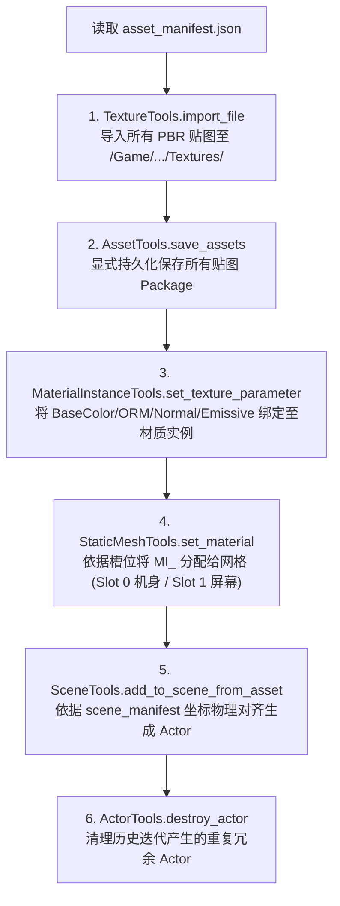
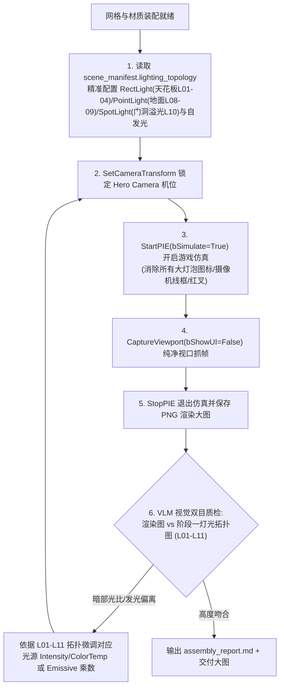

# 阶段四与五：虚幻引擎 MCP 装配与仿真闭环质检 (UE MCP Assembly & PIE Verification Loop)

本 Skill 专门负责通过 **UE MCP (`http://127.0.0.1:8000/mcp`)** 直接操控运行中的虚幻引擎编辑器，将阶段二/三生成的物理网格与 PBR 贴图持久化导入、自动化创建母材质与材质实例、原地无缝替换白模，并通过 **PIE 游戏仿真抓帧闭环（`StartPIE` $\rightarrow$ `CaptureViewport` $\rightarrow$ `StopPIE`）** 由 VLM 视觉模型进行双目比对与动态调优，完成工业级场景交付。

---

## 一、输入与输出契约 (Contract)

* **前置依赖（Precondition）**：
  * 磁盘上必须同时存在 `scene_manifest.json` 与 `asset_manifest.json`；
  * `asset_manifest.json` 中列出的所有模型 (`.fbx`/`.glb`) 与贴图 (`.png`) 物理存在；
  * 虚幻引擎处于运行状态且 MCP 服务正常监听在 `http://127.0.0.1:8000/mcp`。
* **核心输出（Postcondition）**：
  * 关卡内白模已 1:1 被替换为带材质高精资产，零浮空、零穿模；
  * 所有 Stationary 光源重叠红叉已消除；
  * 交付产物：`assembly_report.md` 及纯净游戏仿真多视角视口抓帧大图。

---

## 二、UE MCP 自动化装配流程 (Stage 4)

装配全流程通过 MCP Toolset 矩阵驱动，严禁现场裸写离线脚本：



### 1. 材质与物理通道规范
* **母材质 (`M_Master_PBR`)**：暴露标准参数 `BaseColor`、`Normal`、`ORM`、`Emissive`；
* **参数绑定规则**：
  * `BaseColor` 绑定 `T_*_BaseColor.png`（sRGB=True）；
  * `Normal` 绑定 `T_*_Normal.png`（Linear，TC_Normalmap）；
  * `ORM` 绑定 `T_*_ORM.png`（Linear，R=AO, G=Roughness, B=Metallic）；
  * `Emissive`：仅在切槽资产（如 CRT 屏幕 `MI_V2_CRT_Screen`）中绑定 `T_CRT_Screen_Emissive.png`，产生亮绿荧光。

### 2. 神经-符号物理吸附与去重 (Physics Snapping)
* 避免 VLM 猜坐标导致的漂移，程序化执行物理吸附：
  * 桌脚、椅脚底面严格对齐地面接触面 $Z = 0.0\text{ cm}$；
  * 桌面放置物（CRT 显示器、PC 主机、易拉罐）严格吸附于桌面基准面 $Z = 75.0\text{ cm}$；
  * 一键检索并清理历史冗余 Actor，杜绝重叠堆积。

---

## 三、阶段五：灯光拓扑装配、PIE 仿真与 VLM 视觉闭环 (Stage 5)



### 1. 引擎灯光系统对标装配规范 (基于 Stage 1 Lighting Topology)：
* **天花板实用光源 (`[L01~L04]`)**：
  * 生成 `RectLight`，朝向向下（Pitch=-90°），前排冷白（5500K，4000lm），后排（5000K，2500lm），提供基础照度与金属顶板高光；
* **屏幕自发光与色相补光 (`[L05~L07]`)**：
  * `Slot 1` 屏幕材质设置 `EmissiveIntensity = 3.0~3.5`，屏幕前方 5cm 辅以微弱面光源，在桌面上投射洋红/蓝光的环境色染色；
* **地面微光与溢色细节 (`[L08~L11]`)**：
  * 左侧地面青光显示屏（`PointLight` Teal）与右侧紫光屏（`PointLight` Purple），提供地面杂物的冷艳色彩分割；
  * 左侧门洞外冷青大范围聚光灯（`SpotLight` Cyan），作为主逆光/轮廓光，勾勒椅子和柱子边缘；
  * 主机电源指示灯（`Tiny PointLight` Amber/Red，照度 50~60lm）。

### 2. 消除编辑器图元与红叉报错规则：
* **红叉根因**：场景中多盏 Stationary（固定）光源在同一表面投影重叠超过 4 盏；
* **修复动作**：所有动态补充的补光灯与聚光灯，其移动性属性必须统一设置为 `'Movable'`（可移动光源）；
* **纯净仿真铁律**：交付抓帧必须通过 `StartPIE(bSimulate=True)` 运行，确保场景中的点光源大灯泡图标、摄像机线框、PlayerStart 旗帜图标在交付图中 **100% 隐藏**。

---

## 四、开箱脚本调用指引

内置开箱即用的 MCP 驱动器：
```bash
python .agents/skills/ue-scene-assembler/scripts/run_mcp_assembly.py \
  --scene-manifest scene_manifest.json \
  --asset-manifest asset_manifest.json
```
运行后全自动通过 `http://127.0.0.1:8000/mcp` 执行全套导入、绑定、吸附与 PIE 仿真抓帧，生成 `assembly_report.md`，并将状态机推进为 `STAGE_5_VERIFIED`。
