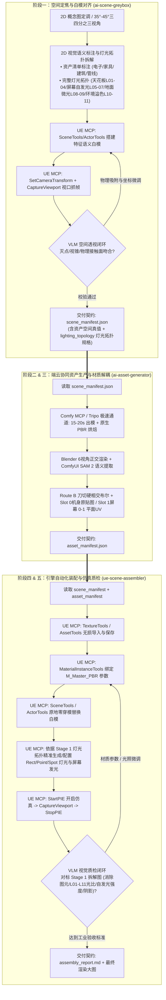

# AI 3D 资产与场景工业级生产管线：智能体总控准则 (Agent Pipeline Orchestrator)

> [!IMPORTANT]
> **【工作区双模运行与条件触发锁 (Workspace Dual-Mode Gate)】**
> 1. **默认模式（大模型理论与技术学习）**：
>    * 当用户进行**大模型原理（Transformer / 注意力机制 / MoE / 微调 / RLHF）、Agent 智能体架构、RAG、提示词工程或通用编程**学习探讨时，**自动旁路（Bypass）本文件后续的 3D 管线规则**；
>    * 智能体以**资深 AI 算法研究员与大模型私教导师**角色进行深度讲解、答疑与代码实操，不强加任何 3D 状态机约束。
> 2. **3D 工业管线模式（显式条件触发）**：
>    * **仅当** 用户明确提出涉及【3D 资产生成】、【虚幻引擎场景搭建 / 装配】、【ComfyUI / Tripo / Blender 自动化管线】或显式提及本文件时，**才激活以下五大阶段状态机与双 MCP 工业级硬性准则**。

---

## 一、五大核心阶段与双 MCP 闭环状态机 (5-Stage State Machine)

整个管线围绕 **“数据契约驱动 + Comfy/UE 双 MCP 互通 + 物理先验吸附 + VLM 视觉反思闭环”** 运转，严格划分为五大生产阶段。**严禁跳步，严禁在未完成上游交付物校验时触发下游技能**：

---

## 二、双 MCP 运行时架构契约 (Runtime MCP Contracts)

管线依赖两个常驻的 MCP 通道，所有引擎操控与 AI 生成必须通过标准化 MCP 协议执行：

1. **UE MCP（虚幻引擎端控）**：
   * **通信端点**：`http://127.0.0.1:8000/mcp`（在全局 `mcp_config.json` 中登记为 `unrealMCP`）；
   * **核心 Toolset 矩阵**：
     * `EditorToolset.EditorAppToolset`：`SetCameraTransform`、`StartPIE(bSimulate=True)`、`CaptureViewport(bShowUI=False)`、`StopPIE`；
     * `editor_toolset.toolsets.scene.SceneTools`：`load_level`、`get_current_level`、`find_actors`、`add_to_scene_from_asset`、`add_to_scene_from_class`；
     * `editor_toolset.toolsets.actor.ActorTools`：`get_actor_transform`、`set_actor_transform`、`destroy_actor`、`get_components`；
     * `editor_toolset.toolsets.texture.TextureTools`：`import_file`；
     * `editor_toolset.toolsets.asset.AssetTools`：`save_assets`、`find_assets`、`exists`；
     * `editor_toolset.toolsets.material_instance.MaterialInstanceTools`：`create`、`set_texture_parameter`、`set_scalar_parameter`、`set_vector_parameter`、`list_parameters`；
     * `editor_toolset.toolsets.static_mesh.StaticMeshTools`：`get_material_slots`、`set_material`、`get_bounds`；
     * `editor_toolset.toolsets.object.ObjectTools`：`set_properties`、`list_properties`。
2. **Comfy MCP（生成式 AI 端控）**：
   * 服务名 `comfy-mcp`，集成 ComfyUI 原生工作流调度；
   * 负责 01 平铺贴图、02/03 贴花海报、SAM 2 语义分割与文生图辅助。
3. **Blender Headless 运行时路径（本地 DCC 工具）**：
   * **绝对路径**：`D:/Blenders/blender.exe`（Blender 4.2 LTS，已配置进环境变量 PATH）；
   * 负责 6 视角正交相机抓帧与 Route B 刀切布尔几何解耦。

---

## 三、三大模块化技能分工与调用指引

| 阶段 | 技能名称 (Skill) | 核心职责 | 开箱执行器 / 驱动核心 | 交付契约 (Postcondition) |
| :--- | :--- | :--- | :--- | :--- |
| **阶段 1** | `ai-scene-greybox` | 2D 概念定调、2D 资产与灯光拓扑语义标注 (L01-L11)、UE 语义灰模搭建、摄像机视锥对齐、零穿模物理基准面标定 | **UE MCP**：`SceneTools` + `ActorTools` + `CaptureViewport` `scripts/greybox_builder.py` | `scene_manifest.json` (含 lighting_topology) |
| **阶段 2+3**| `ai-asset-generator` | ComfyUI 平铺/贴花、Tripo 3D 快速出模+PBR 烘焙、Blender 正交 6 视角、SAM 2 语义提取、Route B 刀切与 UV 重构 | **Comfy MCP** + Tripo API + Blender Headless `scripts/pipeline_engine.py` `scripts/asset_generator_runner.py` | `asset_manifest.json` |
| **阶段 4+5**| `ue-scene-assembler` | 引擎持久化导入、母材质构建、材质实例参数映射、原地无缝替换、依据 Stage 1 灯光拓扑精密布光与消除红叉、PIE 抓帧闭环质检 | **UE MCP**：`TextureTools` + `MaterialInstanceTools` + `StartPIE` $\rightarrow$ `CaptureViewport` `scripts/run_mcp_assembly.py` | `assembly_report.md` + 最终验证大图 |

---

## 四、智能体决策流与前置强约束 (Preflight Check Rules)

1. **阶段 1 启动前**：必须明确场景主题或 2D 概念图（必须满足 35°~45° 斜三四分之三视角以规避 3D 扩散对称性幻觉），并完成 **2D 视觉资产标注图** 与 **场景完整灯光拓扑拆解（L01~L11）**；
2. **阶段 2/3 启动前**：必须在磁盘上检测到合法的 `scene_manifest.json`，严禁在缺少空间真值清单时空转 3D 算力；
3. **阶段 4/5 启动前**：必须在磁盘上同时检测到 `scene_manifest.json` 与 `asset_manifest.json`，且所有涉及的模型文件和 PBR 贴图路径均通过物理存在校验；
4. **代码执行铁律（No Ad-hoc Code）**：
   * 严禁在对话中现场手写大段临时非受控脚本驱动 UE 或 ComfyUI；
   * 必须统一调用对应 Skill 下测试成熟的开箱执行器或标准化 MCP Client 工具；
5. **双闭环验证铁律（Closed-Loop Rules）**：
   * **阶段一闭环**：必须通过 UE MCP 视口抓帧与概念图比对，确认相机视锥、灭点与灰模比例吻合后方可导出 `scene_manifest.json`；
   * **阶段五闭环**：必须对照阶段一标定的 `lighting_topology` 灯光拓扑图，通过 UE MCP 的 `StartPIE(bSimulate=True)` 仿真模式抓帧，消除所有编辑器图元（大灯泡、摄像机线框、PlayerStart 图标），进行 VLM 视觉双目质检（贴图质感、屏幕绿荧光/洋红/蓝光自发光、主辅光照光比与阴影），不达标则通过 MCP 反向微调参数，直至收敛。

