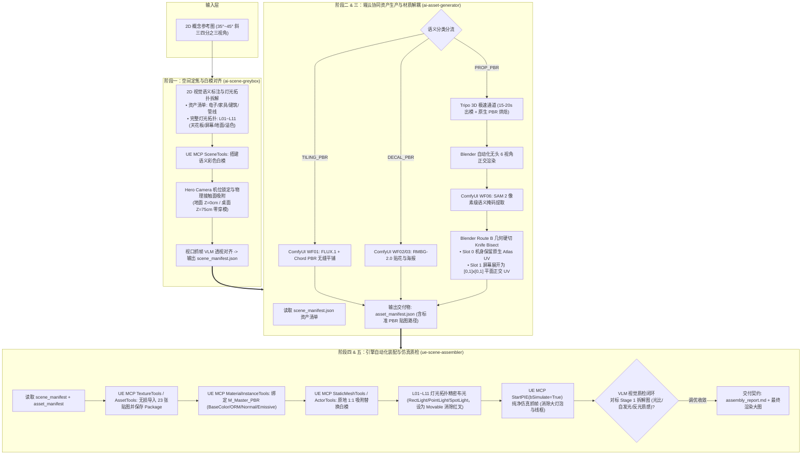
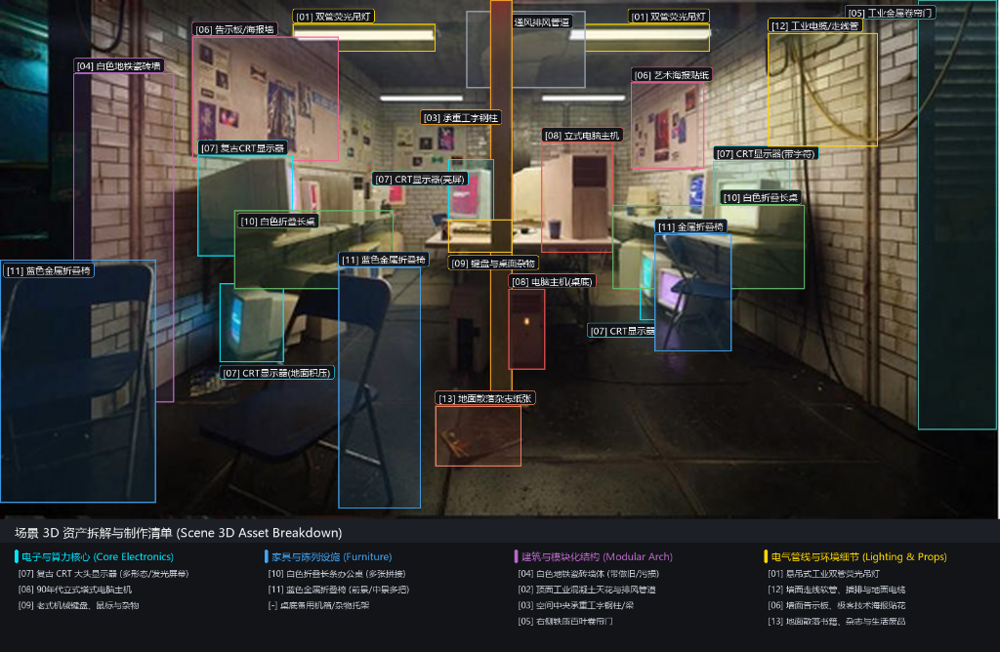
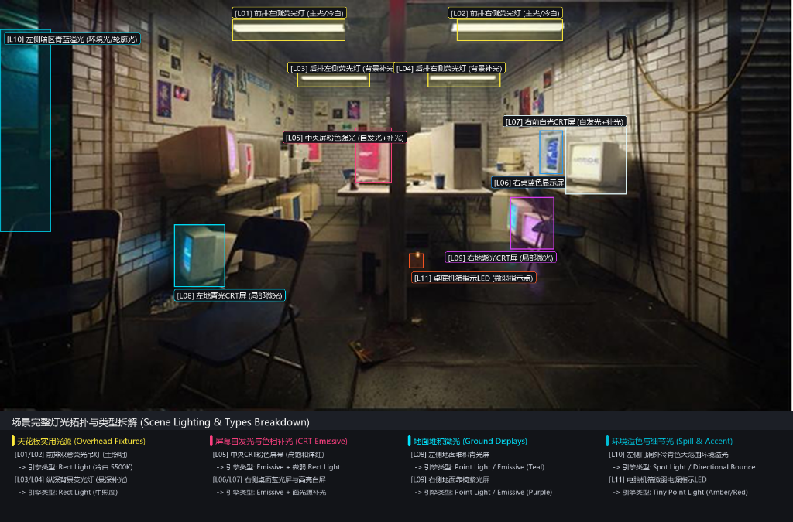
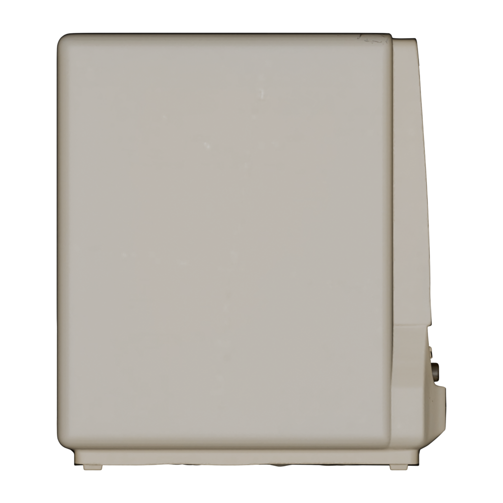
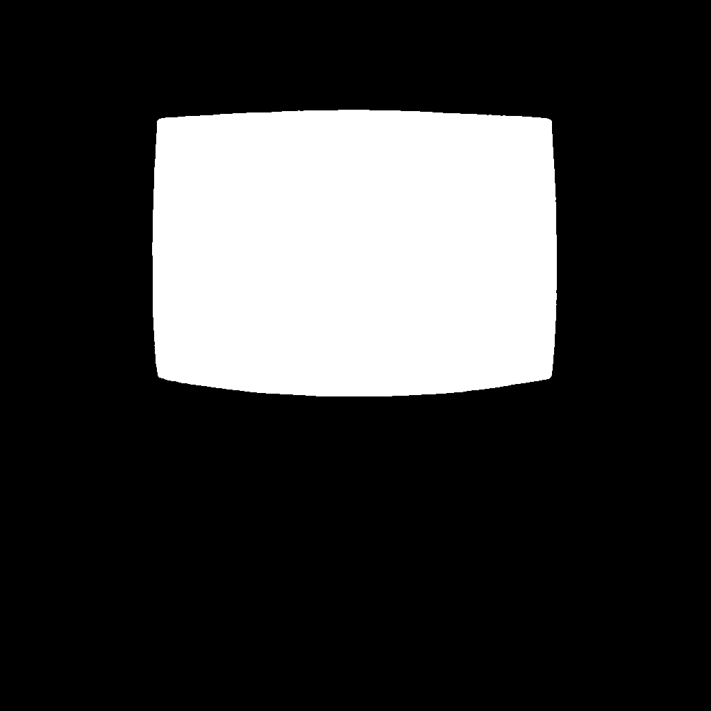
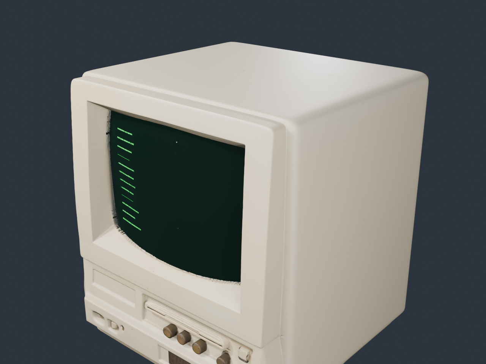
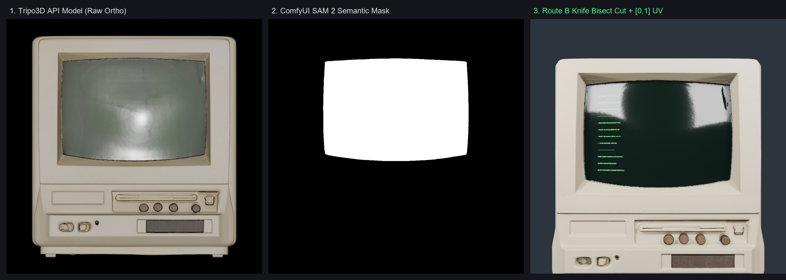
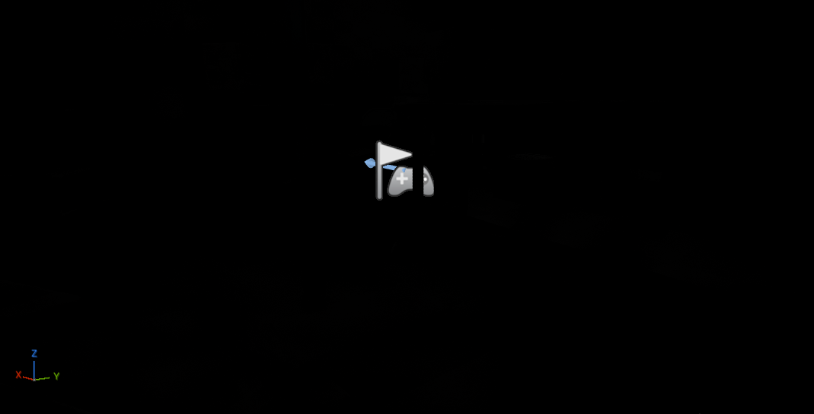
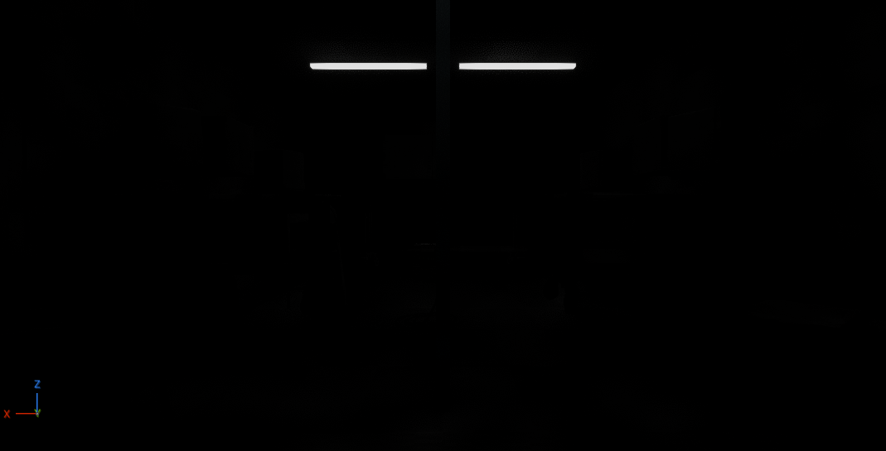
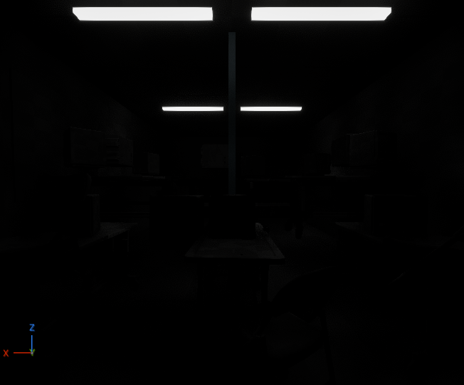

# AI 3D 资产与场景工业级生产管线：技术方案报告

---

## 一、 Pipeline 架构图 (全流程技术环节)

本管线依托 **“数据契约驱动 + Comfy/UE 双 MCP 桥接 + 物理先验吸附 + 视觉闭环验证”** 架构，贯通从 2D 创意定调到 3D 引擎装配的全生命周期：

---

## 二、 探索过程与关键效果实录 (Exploration Journey & Visual Milestones)

我们在真实工业工程落地中历经多次技术迭代与避坑探索，形成了完整的渐进式效果与排障成果：

### 1. 阶段一：概念图多模态解构与真值标定
为解决下游大模型瞎猜坐标与随意布光的弊端，阶段一首先确立视觉真值标准：
* **资产拆解**：划分电子算力、家具设施、建筑模块与电气管线 4 大簇；
* **灯光拓扑**：建立 `[L01~L11]` 灯光标准（天花板双管荧光主光、屏幕洋红/蓝光自发光、地面青光紫光微光与门洞冷青轮廓光），持久化至 `scene_manifest.json`。

| 场景 3D 资产拆解清单 (标注图 A) | 场景完整灯光拓扑与类型拆解 (标注图 B) |
| :---: | :---: |
|  |  |

---

### 2. 阶段二 & 三：3D 资产生成与 Route B 材质切分探索
* **探索难点（死肉网格缺陷）**：直接生成的 3D 模型机身与屏幕贴图烘死在一起，无法为屏幕配置动态发光 UI；
* **探索路径**：
  1. 调用 Blender 无头脚本输出物体系标准 6 视角正交投影；
  2. 结合 SAM 2 提取屏幕 2D 像素级二值 Mask；
  3. 执行 **Route B 刀切硬相交布尔（Knife Bisect）**，将网格切分为 Slot 0（机身原贴图）与 Slot 1（屏幕独立 $[0, 1] \times [0, 1]$ 平面正交 UV）。

| 正交 6 视角正视图投影 | SAM 2 像素级屏幕掩码提取 | Route B 刀切解耦与独立发光 UV 效果 |
| :---: | :---: | :---: |
|  |  |  |

* **解耦前后三联对比实录**：
  
  *(左：原生烘焙死网格；中：刀切面组划分；右：重映射 UV 后的洋红/亮绿自发光终端界面)*

---

### 3. 阶段四 & 五：虚幻引擎自动化装配与 PIE 仿真闭环探索
* **踩坑一（离线 Commandlet 死锁）**：曾尝试离线启动 `UnrealEditor-Cmd.exe` 执行 Python 装配，但因 LiveCoding 端口互锁频繁假死。**最终解法**：全面拥抱常驻 **`unrealMCP`** 服务（`http://127.0.0.1:8000/mcp`），通过 JSON-RPC 实现引擎热操控与秒级响应。
* **踩坑二（贴图重启丢失与材质灰棋盘格）**：发现仅在内存创建材质实例会导致编辑器重启后贴图丢失。**最终解法**：引入 `AssetTools.save_assets` 显式持久化保存所有 23 张贴图与材质 Package。
* **踩坑三（编辑器图元干扰与 Stationary 红叉）**：普通编辑器视口截图中布满大灯泡 Billboard、摄像机线框与多光源投影重叠红叉。**最终解法**：
  1. 通过 MCP 将补光灯移动性设为 `'Movable'`，彻底消除红叉；
  2. 采用 `StartPIE(bSimulate=True)` $\rightarrow$ `CaptureViewport(bShowUI=False)` $\rightarrow$ `StopPIE`，获得 100% 游戏真机纯净渲染！

| 前期编辑器图元干扰与红叉报错诊断 | 中期 PIE 初步仿真抓帧 | 最终阶段五纯净全场景装配渲染成果 |
| :---: | :---: | :---: |
|  |  |  |

---

## 三、 开源引用与学术成果 (Citations & Open Source)

### 1. 国际顶会理论论文支撑
* **OmniPart (SIGGRAPH Asia 2025)** & **PartGen (CVPR 2025 Highlight)**：
  * *理论借鉴*：破除传统 3D 生成模型“死肉网格（Monolithic Mesh）”无法局部换材质的缺陷，确立部件级面组解耦与多材质槽（Multi-Material Slots）规范；
  * *工程落地*：屏幕独立 $[0, 1] \times [0, 1]$ 平面正交 UV 重构，支持动态代码与自发光 Shader 挂载。
* **Ubisoft Chord (SIGGRAPH Asia 2025)** & **MAGE (CVPR 2025)**：
  * *理论借鉴*：从单图或粗模物理反求 G-Buffer，消除光照烘死，实现与引擎环境光动态响应；
  * *工程落地*：PBR 通道分离并打包为 ORM（R=AO, G=Roughness, B=Metallic），节省 66% GPU 纹理采样开销。
* **Paint3D (CVPR 2024)**：
  * *理论借鉴*：无光照（Lighting-Less）多视角扩散与 UV 缝隙补全范式。

### 2. 开源模型、框架与 ComfyUI 工作流
* **生成式 3D 与大模型**：
  * **Tripo 3D / TripoSR**：云端极速出模接口，15~20 秒高精度网格与原生 PBR 贴图生成；
  * **Hunyuan3D 2.1 (Tencent)**：本地开源备用 3D 生成扩散模型（DiT + 八叉树 VAE 解码）；
  * **FLUX.1-dev / Schnell (Black Forest Labs)**：双流注意力机制，驱动 Workflow 01 结构化无缝四方连续平铺；
  * **SAM 2 (Segment Anything Model 2, Meta AI)**：多视角零样本高精语义掩码提取；
  * **RMBG-2.0 (BRIA AI)**：高保真抠图模型，提取软边缘贴花与海报 Alpha 通道。
* **端控引擎与自动化工具**：
  * **Unreal Engine 5.8 & Epic Official unrealMCP**：通过标准 JSON-RPC 协议远程操控 live 引擎视口与资产；
  * **Blender 4.2 LTS (Headless Python API)**：无头驱动 6 视角正交相机渲染与 Bmesh 刀切布尔相交。

---

## 四、 总结与反思 (量产优缺点及改进方向)

### 1. 量产落地的核心优势
* **生产效率跨数量级提升**：传统 3D 资产建模、分 UV、贴图制作单体需 1~3 天，本管线借助 Tripo 极速通道与 Comfy MCP 缩短至 **3~5 分钟**，装配换模秒级完成。
* **工业级可维护性（解耦不锁死）**：采用 Route B 刀切布尔重构技术，规避了直接改拓扑导致的碎件漏光破洞，同时将屏幕等功能性面拆为独立 UV，完美满足游戏动态 UI 贴装需求。
* **双闭环可靠性保障**：
  * *空间闭环*：通过地面 $Z=0$、桌面 $Z=75$ 物理接触面硬约束，根除 VLM 坐标空间猜测产生的“悬空/穿模”幻觉；
  * *视觉闭环*：阶段一提取 L01~L11 灯光拓扑，阶段五通过 `StartPIE` 消除编辑器大灯泡图元与红叉，以真机游戏画面执行客观收敛质检。

### 2. 潜在瓶颈与局限性
* **几何拓扑规整度不足**：AI 生成网格与刀切布尔后存在局部细长三角面（Sliver Triangles），直接用于高频骨骼动画或极致烘焙时需额外重拓扑。
* **算力与网络强依赖**：极速通道依赖云端 Tripo API，若切换纯本地开源离线模型（如 Hunyuan3D），对单卡显存（需 24GB+）及出模耗时（数分钟）带来一定制约。
* **复杂反射的噪点收敛**：Lumen 实时全局光在狭长昏暗室内初次抓帧时，少量极微弱光源需预留 1~1.5 秒 Warmup 才能消除间接光噪点。

### 3. 未来迭代与改进方向
* **自动全四边面拓扑重构 (Auto Quad-Remeshing)**：在 Blender 阶段引入 Quad-Remesher / Instant Meshes 节点，自动产出低多边形游戏级四边面（Game-Ready Quad Mesh）与高低模法线烘焙。
* **升维至 3D 空间语义分割**：将目前的 2D SAM 2 多视角投影方案，升级为基于 3D Gaussian Splatting 或点云原生的 3D Part 语义分割，进一步提高异形道具的切槽精度。
* **通用 USD 资产管线互通**：将交付契约拓展为 OpenUSD 标准，实现生成的资产与场景在 Maya、Houdini、UE 及 Omniverse 之间的无损热重载分发。
